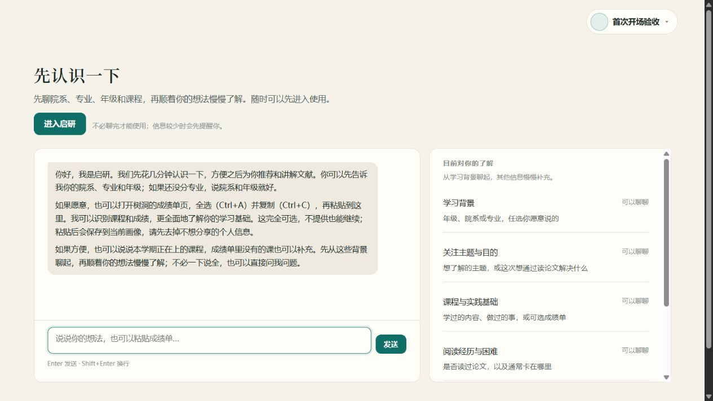
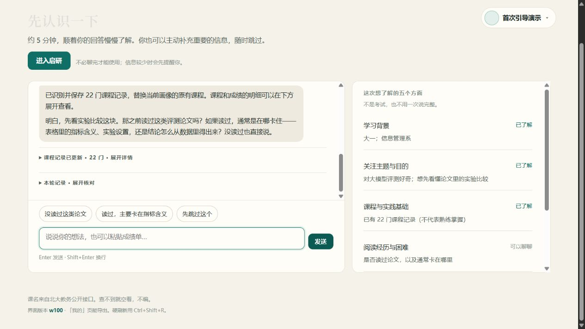
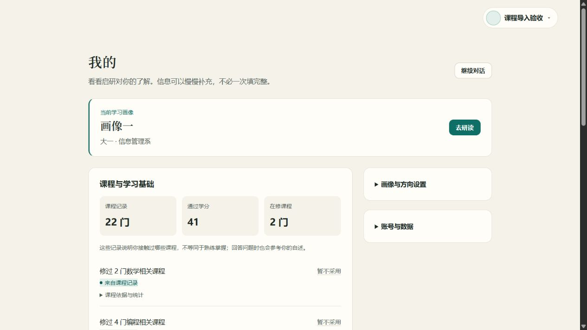

# 对话模块调整与验收（w101）

## 最终行为

- 对话仅了解背景、维护画像、回答问题；取消对话任务创建、接受与完成入口。项目模块和历史任务保留，独立研读 Agent 的带读与判答不变。
- 保留七个只读工具：course.search、transcript.summary、major_lookup、major_detail、match_transcript、minor_programs、course_lookup。院系简称规范化与专业背景理解保留，培养方案不能直接视为用户掌握程度。
- 首次开场先邀请院系、专业、年级和可选成绩单，再可选补充本学期在修课程；未分专业可以只说院系、年级。之后顺着用户的话交流，已有信息不重复追问。
- 成绩单确定性处理后继续同轮对话，替换/追加/只预览语义分开；预览不落课程与派生能力，但正常聊天消息仍保存。长聊记得曾经预览过，不能将“没导入”说成“从未预览”。
- 自动推荐开始需要主题/目的明确且五方面至少了解四个，仅是提示。所有进入入口统一处理；信息少时弹“再聊一聊 / 直接进入”，不设硬门槛。显式进入前刷新仍留在首次界面，进入后不重做访谈。
- 登录/注册统一表单风格。“我的”优先呈现课程与可修改记忆，账号与选填设置折叠；移除缺项压力与任务难度文案。对话中间不再有独立小滚动区，回执随回复、建议归输入区，长成绩单原文折叠。

## 证据

提交 PR 前，以下相关回归一次执行 **376 项通过**，包括认证和账号隔离、首次引导、成绩单、记忆、保留工具、前端渲染及独立 tutor：

```sh
python -m pytest server/tests/test_guide.py server/tests/test_dialogue.py server/tests/test_dialogue_libfacts.py server/tests/test_api_dialogue.py server/tests/test_auth.py server/tests/test_auth_password.py server/tests/test_user_store.py server/tests/test_enter.py server/tests/test_memory.py server/tests/test_transcript.py server/tests/test_transcript_in_dialogue.py server/tests/test_transcript_continuation.py server/tests/test_tools.py server/tests/test_task_bridge.py server/tests/test_web_assets.py server/tests/test_render_layer.py server/tests/test_tutor.py -q
```

测试使用临时数据库和模型替身，未使用个人账号数据或模型密钥。另以配置的真实模型完成最终两组持续会话 **18 轮（12/6）**，零降级、零被拒记忆写入、零新增任务/行动，流式与最终正文一致。不是在轮间清空记忆的单轮样例。原始输入与输出见[完整实录](dialogue-2026-10-18-transcript.md)，内容为虚构背景与虚构成绩。

最终场景覆盖纯成绩单后先问身份、未分专业、补充在修课、没有科研经历、拒绝成绩单、主动聊 coding agent、回忆偏好与课程、停止采集及提前进入。真实浏览器另验证新注册开场；此前浏览器已验收低信息确认、取消保留草稿、直接进入、信息充分免确认、刷新及 390px 窄屏。

### 首次开场



### 对话输入区



### 我的页面



## 边界与实际局限

- 自动推荐覆盖度和可访问权限是两回事；没主题也可以确认后进入，不要求填满资料。
- 自由回复偶尔仍会重复导入确认或解释偏长，实录保留原文，不声称每次措辞完全自然。
- 课程表用于核对；修改底稿通过重新导入，不提供表内逐行编辑。
- 历史欢迎语不改写，新欢迎语对新账号首次开场生效；更早日期的老账号兼容判断保留。
- 本地用户清理是开发环境操作，已先做一致性备份；删除脚本、数据库、备份与密钥均未纳入本 PR，线上数据未动。PR 不包含生产部署。
